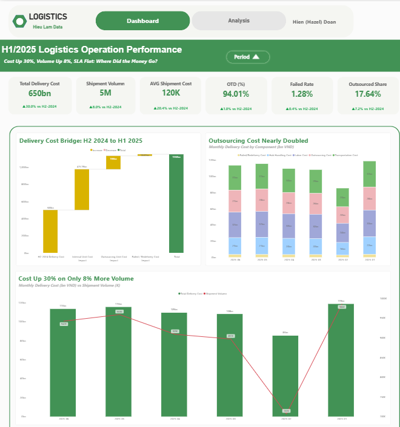

# Logistics Cost Analysis: Why Did Delivery Cost Rise 30% While SLA Stayed Flat?

> **End-to-end analytics case study:** SQL data cleaning (DBeaver) → Power BI dashboard → executive summary.

**Author:** Hien (Hazel) Doan · [LinkedIn](https://www.linkedin.com/in/hien-hazel-doan-59b318269) · [Email](mailto:hazeldoan215@gmail.com)

---

## 1. Business Problem

Between H2-2024 and H1-2025, a logistics operator's total delivery cost rose from **VND 500bn to 650bn (+30%)**, while shipment volume grew only from **5.0M to 5.4M (+8%)**. Despite the spending, the on-time delivery (OTD) rate barely improved, from **93.1% to 94.0%** (less than 1 percentage point).

**Business question:** Why did delivery cost rise so sharply while on-time delivery barely improved?

**Data question:** Using operational and cost metrics, identify the largest contributor to the cost increase and the root cause that should be prioritized.

---

## 2. Key Findings

| # | Finding | Evidence |
|---|---|---|
| 1 | **Volume is not the main driver** | Volume explains only ~VND 40bn (26.7%) of the VND 150bn increase; cost per shipment rose 20.4% (VND 100K → 120K) |
| 2 | **Outsourcing is the largest single driver** | Outsourcing cost ~VND 80bn → 156bn (+76bn, ~half of the increase); outsourced shipments 522K → 953K; outsourced share 10.4% → 17.64% |
| 3 | **Internal cost per shipment also rose** | Internal volume was flat (~4.45M), yet internal cost per shipment rose ~17% (VND 91K → 107K) and internal cost rose ~VND 66bn (labor +25.1bn, transportation +24.4bn, hub handling +16.5bn) |
| 4 | **Root cause: three overloaded hubs** | Binh Duong, Hai Phong, Long An run at 108.7% utilization (others 95.2%), backlog ~3.4x, misroute rate 1.2% → 1.8%, rider productivity −20% (7.4 → 5.9 shipments/rider) |
| 5 | **Rescue outsourcing did not buy quality** | Volume concentrated in LocalPartner (share 30.8% → 43.8%), the weakest vendor: OTD 89.5% (−2.2 pp), fail rate 14.2% (+3.7 pp) |
| 6 | **Other hypotheses ruled out** | Order mix unchanged (COD ~55%, inter-province 36% → 37%); failed-delivery cost rose VND 8bn but is only ~3% of total; delivery times within SLA targets |

**Causal chain:**
`3 overloaded hubs → weaker delivery, rising backlog, lower productivity → outsourcing as a rescue → chosen vendors also underperform → cost +30%, SLA flat`

---

## 3. Analytical Approach

### Framework
- **Logic tree:** total delivery cost is decomposed with the cost identity below, to show what can drive the increase.
- **Hypothesis tree (MECE):** each branch carries a non-overlapping group of hypotheses (volume and mix, internal cost, failed deliveries, outsourcing), each tested with SQL and Power BI.

```
Total Delivery Cost = Successful-delivery (internal) cost
                    + Failed / redelivery cost
                    + Outsourcing cost
```

### Hypothesis tree and verdict

| Group | Hypothesis | Verdict |
|---|---|---|
| **A** | Volume and order mix (weight, COD, geography, service) | Volume explains ~27% of the increase; mix ruled out |
| **B** | Internal cost per shipment (labor, productivity, transport, hub handling) | **Confirmed**, concentrated in three hubs |
| **C** | Failed / redelivery cost | Increased (+VND 8bn), but ~3% of cost; a symptom of overload |
| **D** | Outsourcing (capacity, vendor mix and price, route difficulty, vendor performance) | **Confirmed** as the largest driver |

---

## 4. Data

- **Source:** case-study dataset (10 hubs, 3 outsourcing vendors, 12 months from Jul-2024 to Jun-2025, ~10.4M shipments), hosted in an online database and accessed through DBeaver. **Raw data is not included in this repository.**
- **Comparison periods:** H2-2024 vs H1-2025.
- **Database:** schema `case2_logistic` (7 tables in a star schema: 3 dimensions and 4 fact tables), cleaned and validated with SQL in DBeaver.
- **Main entities:** shipments / delivery cost, hubs, vendor performance, calendar. See [`docs/data_dictionary.md`](docs/data_dictionary.md) for tables, columns, relationships and metric definitions.

---

## 5. Dashboard

Built in Power BI Desktop (2 report pages).



**Page 1: Dashboard (executive view)**
- KPI cards: total cost, volume, cost per shipment, OTD, failed rate, outsourced share
- Delivery cost bridge (H2-2024 → H1-2025)
- Monthly cost vs volume, cost by component, OTD trend
- Outsourced share by hub

**Page 2: Analysis (diagnostic view)**
1. **Volume & Mix:** volume effect, mix by route, payment, size and service; hub cost and SLA
2. **Internal Cost:** cost by line, headcount, overtime, productivity, hub load / backlog / misroute
3. **Outsourcing:** hub utilization vs outsourced share, vendor mix and OTD, vendor cost and cost per on-time delivery, mix vs price effect, route complexity, vendor scorecard
4. **Failed Delivery:** first-attempt fail, redelivery, return-to-sender, delivery days vs SLA

---

## 6. Recommendations

1. **Fix capacity at the three focus hubs (root cause):** add staff where needed or reroute flow to neighboring hubs with spare capacity; set early-warning alerts when utilization exceeds 100% or backlog keeps rising.
2. **Control outsourcing:** cap the outsourced share (benchmark ~13%, in line with normally operating hubs).
3. **Restructure the vendor portfolio:** reduce LocalPartner's share until OTD and fail rate improve; evaluate vendors on **cost per on-time delivery** rather than unit price, and tie contracts to OTD and fail-rate targets.

---

## 7. Repository Structure

```
logistics-cost-analysis/
├── README.md
├── dashboard/
│   ├── dashboard_overview.png                     # Dashboard preview used in this README
│   ├── Logistics_Cost_Analysis_Dashboard.pbix     # Power BI report
│   ├── Logistics_Cost_Analysis_Report_EN.pdf      # Executive summary and dashboard (English)
│   └── Logistics_Cost_Analysis_Report_VI.pdf      # Executive summary and dashboard (Vietnamese)
├── sql/
│   └── logistics_data_cleaning_and_validation.sql # grain, NULL/logic checks, anomaly handling, reconciliation, dashboard validation
└── docs/
    └── data_dictionary.md                         # tables, columns, relationships, metric definitions
```

---

## 8. Validation and Reproducibility

The source data is private and is not included, so the analysis cannot be re-run from this repository. Instead, the repository documents the work so that it can be audited:

- **SQL file:** every check and validation query is followed by its result (as a comment), so the row counts, data anomalies and reconciled totals can be read without running anything.
- **Dashboard validation:** Section VI of the SQL file reproduces the figures shown in the dashboard (e.g., H1-2025 cost = VND 650bn, outsourcing = VND 156bn, volume effect = VND 40bn).
- **Data dictionary:** schema, grains, relationships and metric definitions, so the queries can be applied to a similar schema.
- **Dashboard:** the final report is provided in the `dashboard/` folder.

---

## 9. Assumptions and Limitations

- **OTD definition:** the dashboard uses the raw on-time field. 9,889 records (15–19% of rows per period) have negative late-delivery counts, with on-time deliveries exceeding successful deliveries. These rows are flagged, not deleted or corrected. Raw OTD moved from 93.1% to 94.0% (+0.95 pp) and capped OTD from 92.1% to 92.7% (+0.55 pp), so the conclusion that SLA barely improved holds either way, but the OTD level is overstated by roughly 1 pp.
- **Internal cost split:** labor, transportation and hub handling are taken as recorded in the cost table; the **transportation** increase is not backed by distance, load or route metrics, so its cause is not established.
- **Vendor selection:** the data shows which vendors received volume (including by hub) but not *why* volume was routed to LocalPartner (e.g., regional coverage or contract terms).
- **Price effect:** the vendor price effect includes both contract price changes and a harder route mix.
- **Period comparison:** two half-year windows without a prior-year comparison, so seasonality is not controlled for.
- **Dataset:** a case-study dataset, so findings illustrate the analytical approach rather than a specific real-world company.

---

## 10. Tools

SQL (DBeaver) · Power BI Desktop (DAX, data modeling) · Excel / CSV

---

## 11. Related Work

- [Case 1: Loan Disbursement Performance Analysis](https://github.com/hazeldoan215/loan-disbursement-performance-analysis)

---

*Feedback and suggestions are welcome via issues or LinkedIn.*
