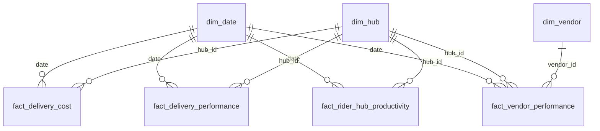

# Data Dictionary

**Schema:** `case2_logistic` · **Period:** Jul-2024 to Jun-2025 (365 days) · **Comparison:** H2-2024 vs H1-2025

The schema follows a star design: 3 dimension tables and 4 fact tables. This dictionary documents the columns used in the analysis (SQL validation and Power BI model). Row counts and grains come from the checks in `logistics_data_cleaning_and_validation.sql`.

---

## 1. Overview

| Table | Type | Grain | Rows |
|---|---|---|---|
| `dim_date` | Dimension | 1 row per day | 365 |
| `dim_hub` | Dimension | 1 row per hub | 10 |
| `dim_vendor` | Dimension | 1 row per outsourcing vendor | 3 |
| `fact_delivery_cost` | Fact | date × hub × service × route × payment × size | 58,400 |
| `fact_delivery_performance` | Fact | date × hub × service × route × payment × size | 58,400 |
| `fact_rider_hub_productivity` | Fact | date × hub | 3,650 |
| `fact_vendor_performance` | Fact | date × hub × vendor | 10,950 |

**How the row counts fit together:** 10 hubs × 365 days = 3,650 hub-days. Each hub-day has 16 segments (2 service × 2 route × 2 payment × 2 size) in the two delivery fact tables (3,650 × 16 = 58,400) and 3 vendors in the vendor table (3,650 × 3 = 10,950).

---

## 2. Entity Relationship Diagram

All foreign keys were checked: no fact row has a hub, vendor or date missing from its dimension table.

---

## 3. Dimension Tables

### `dim_date`
| Column | Description |
|---|---|
| `date_key` | Unique key of the day (grain of the table) |
| `date` | Calendar date; joined to the `date` column of each fact table |

### `dim_hub`
| Column | Description |
|---|---|
| `hub_id` | Unique key of the hub |
| `hub_name` | Hub name (Binh Duong Hub, Hai Phong Hub, Long An Hub, Bac Ninh Hub, Can Tho Hub, Da Nang Hub, Dong Nai Hub, Ha Noi Central, Ho Chi Minh Central, Nha Trang Hub) |

### `dim_vendor`
| Column | Description |
|---|---|
| `vendor_id` | Unique key of the vendor |
| `vendor_name` | FastShip Express, LocalPartner Network, Economy Courier |

---

## 4. Fact Tables

Shared segment columns (appear in both delivery fact tables):

| Column | Values |
|---|---|
| `service_type` | Express, Standard |
| `route_type` | Inter-province, Urban |
| `payment_type` | COD, Prepaid |
| `size_type` | Bulky, Small |

### `fact_delivery_cost`
Daily delivery cost by hub and segment (VND).

| Column | Description |
|---|---|
| `date`, `half_year`, `hub_id` | Day, half-year label (`H2_2024` or `H1_2025`) and hub |
| `service_type`, `route_type`, `payment_type`, `size_type` | Segment (see above) |
| `labor_cost` | Labor cost |
| `transportation_cost` | Transportation (linehaul and last-mile) cost |
| `hub_handling_cost` | Hub handling cost |
| `failed_redelivery_cost` | Cost of failed deliveries and redeliveries |
| `outsourcing_cost` | Cost paid to outsourcing vendors |
| `total_delivery_cost` | Sum of the five cost components above |

### `fact_delivery_performance`
Daily shipment volume and delivery outcomes by hub and segment.

| Column | Description |
|---|---|
| `date`, `half_year`, `hub_id` | Day, half-year label and hub |
| `service_type`, `route_type`, `payment_type`, `size_type` | Segment (see above) |
| `shipment_volume` | Shipments handled (= `internal_shipments` + `outsourced_shipments`) |
| `internal_shipments` | Shipments delivered by internal resources |
| `outsourced_shipments` | Shipments delivered by outsourcing vendors |
| `successful_deliveries` | Shipments delivered successfully |
| `on_time_deliveries` | Successful deliveries made on time |
| `late_deliveries` | Successful deliveries made late (see data quality notes) |
| `first_attempt_failed_shipments` | Shipments that failed on the first delivery attempt |

### `fact_rider_hub_productivity`
Daily staffing, workload and capacity by hub.

| Column | Description |
|---|---|
| `date`, `half_year`, `hub_id` | Day, half-year label and hub |
| `rider_count` | Riders working that day |
| `hub_staff_count` | Hub staff working that day |
| `working_hours` | Total working hours |
| `overtime_hours` | Overtime hours (included in or compared against `working_hours`) |
| `internal_shipments` | Shipments handled internally (reconciles to `fact_delivery_performance`) |
| `successful_deliveries` | Successful deliveries for the hub-day, **including outsourced shipments** (see data quality notes) |
| `hub_capacity` | Daily hub capacity |
| `capacity_utilization` | Load relative to capacity; values above 1 indicate overload |
| `misroute_rate` | Share of shipments misrouted |

### `fact_vendor_performance`
Daily outsourced volume, cost and quality by hub and vendor.

| Column | Description |
|---|---|
| `date`, `hub_id`, `vendor_id` | Day, hub and vendor |
| `outsourced_shipments` | Shipments handled by the vendor |
| `vendor_cost` | Cost paid to the vendor (VND) |
| `vendor_on_time_deliveries` | Shipments the vendor delivered on time |
| `vendor_first_attempt_failed_shipments` | Shipments the vendor failed on the first attempt |

---

## 5. Metric Definitions

| Metric | Definition |
|---|---|
| Total delivery cost | `SUM(total_delivery_cost)` |
| Internal cost | `labor_cost + transportation_cost + hub_handling_cost` |
| Cost per shipment | Total delivery cost ÷ `shipment_volume` |
| Internal cost per shipment | Internal cost ÷ `internal_shipments` |
| Outsourcing cost per shipment | `outsourcing_cost` ÷ `outsourced_shipments` |
| Outsourced share | `outsourced_shipments` ÷ `shipment_volume` |
| OTD (on-time delivery rate) | `on_time_deliveries` ÷ `successful_deliveries` (raw; see data quality notes) |
| First-attempt fail rate | `first_attempt_failed_shipments` ÷ `shipment_volume` |
| Vendor OTD | `vendor_on_time_deliveries` ÷ `outsourced_shipments` |
| Vendor fail rate | `vendor_first_attempt_failed_shipments` ÷ `outsourced_shipments` |
| Vendor cost per on-time delivery | `vendor_cost` ÷ `vendor_on_time_deliveries` |
| Shipments per rider | `internal_shipments` ÷ `rider_count` |
| Shipments per working hour | `internal_shipments` ÷ `working_hours` |
| Overtime share | `overtime_hours` ÷ `working_hours` |
| Volume effect | H2-2024 total cost × (H1-2025 volume ÷ H2-2024 volume − 1) |

All rates are weighted ratios of sums, not averages of daily rates. Measure definitions in the Power BI model may differ slightly (for example, weighting of the misroute rate).

---

## 6. Data Quality Notes

| Check | Result |
|---|---|
| Grain and duplicates | No duplicates in any table; row counts match the expected grain |
| NULL values | None in any fact table |
| Negative or zero costs and volumes | None |
| Cost components vs total | `total_delivery_cost` equals the sum of its components in every row |
| Referential integrity | All hub, vendor and date keys exist in their dimensions |
| Date coverage | 2024-07-01 to 2025-06-30, no missing days |
| Volume split | `shipment_volume = internal_shipments + outsourced_shipments` in every row |
| Vendor reconciliation | Vendor cost (VND 236bn) and outsourced shipments (1,475,200) equal the totals in the cost and performance tables |
| **Negative `late_deliveries`** | **9,889 rows**; the same rows have `on_time_deliveries > successful_deliveries`. Rows are flagged, not corrected or deleted. Raw OTD is used in the dashboard; a capped OTD is compared in the SQL file |
| `capacity_utilization > 1` | 543 rows (equal to 3 hubs × 181 days of H1-2025); this is the genuine overload at the three focus hubs, not a data error |
| `successful_deliveries` in `fact_rider_hub_productivity` | Greater than `internal_shipments` in all 3,650 rows because the column matches total successful deliveries (internal and outsourced). It is therefore not used to compute rider productivity |

---

## 7. Notes

- Column lists cover the fields used in this analysis. Additional columns in the source tables (for example redelivery, return-to-sender or delivery-day fields shown on the Failed Delivery page of the dashboard) are not documented here.
- Segment values are given as displayed in the dashboard; stored values may use different capitalization.
- To list every column and data type directly from the database:
